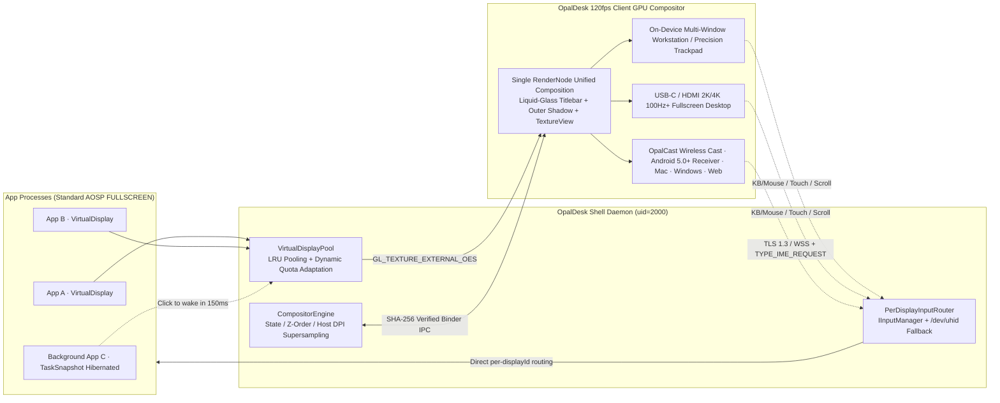

[简体中文](./README.md) | **English**

#  OpalDesk

> **Live Demos & Docs**: [3D Interactive Stage](https://lengsukq.github.io/OpalDesk/) | [2D Real-Device Showcase & Multi-Window Simulator](https://lengsukq.github.io/OpalDesk/overview.html) | [**Web Cast Receiver & LAN Activation**](https://lengsukq.github.io/OpalDesk/cast/) | [User Guide](docs/USER_GUIDE.md) | [Architecture Design](docs/ANDROID_WINDOW_ENGINE_DESIGN.md) | [Download Latest Release](https://github.com/lengsukq/OpalDesk/releases/latest)

**An OEM-agnostic, rootless-first, Wayland-style "one window, one independent VirtualDisplay" 120fps liquid-glass multi-window compositor workstation for Android.**

Ditching vendor-specific Freeform hacks and tearing floating titlebars altogether, OpalDesk targets **Android 11–17** and brings together a **macOS-inspired liquid-glass multi-window desktop**, **USB-C / HDMI 2K/4K high-refresh external fullscreen workstation**, **phone ↔ tablet wireless desktop & floating standalone app windows**, **global cross-display physical keyboard & mouse routing**, a **standalone universal 32/64-bit Android receiver `OpalCast` (Android 5.0–17)**, **native Swift 6 macOS / Tauri v2 Windows companion apps**, and a **zero-install GitHub Pages Web Cast receiver & cable-free LAN activation**—free and open-source under the MIT License, with zero Accessibility permissions and 95%+ pure rootless `uid=2000` execution.

---

## 📸 Real-Device Dual-Hardware Captures (Xiaomi Pad 8 Pro · Xiaomi 14 Pro)

> All screenshots are captured directly from real hardware: **Xiaomi Pad 8 Pro (Android 17 · 3040×1904)** and **Xiaomi 14 Pro (Android 16 · 1440×3200)**.

### 1. On-Device 120fps Liquid-Glass Multi-Window Workstation (Light / Dark Themes + Control Center)

<table>
  <tr>
    <td width="50%" align="center">
      <br/>
      <sub><b>Light Theme 50/50 Split Screen</b> · One independent VirtualDisplay per window + floating liquid-glass Dock</sub>
    </td>
    <td width="50%" align="center">
      <br/>
      <sub><b>Dark Theme + Live Control Center</b> · 60–120Hz frame rate / hot DPI reload / 7 one-tap split-screen presets / custom wallpaper</sub>
    </td>
  </tr>
</table>

### 2. Cross-Device Wireless Interconnect: Phone → Tablet 120Hz Desktop Cast & Floating Standalone App Windows

<table>
  <tr>
    <td width="50%" align="center">
      <br/>
      <sub><b>Phone → Tablet Wi-Fi TLS Wireless Desktop Cast (2560×1600 @ 120Hz)</b> · Independent portrait form factor with zero black bars + automatic remote IME forwarding</sub>
    </td>
    <td width="50%" align="center">
      <br/>
      <sub><b>Cross-Device Floating Standalone App Window</b> · Apps from Xiaomi 14 Pro float over the tablet in macOS-style glass windows (1:1 host DPI supersampling)</sub>
    </td>
  </tr>
</table>

### 3. Phone Liquid-Glass Precision Trackpad & Minimalist Apple HIG Consoles

<table>
  <tr>
    <td width="25%" align="center">
      <br/>
      <sub><b>Phone Precision Trackpad</b><br/>50/50 button bar · drag lock · one-tap Host Screen Off</sub>
    </td>
    <td width="25%" align="center">
      <br/>
      <sub><b>Phone Casting Console</b><br/>Direct Wi-Fi TLS · permanent trust management</sub>
    </td>
    <td width="50%" align="center">
      <br/>
      <sub><b>Tablet Minimalist 3-Card Console</b> · mDNS auto-discovery · one-tap desktop cast / Standalone Window</sub>
      <br/><br/>
      <br/>
      <sub><b>Settings</b> · Usage-based sorting · GitHub Releases SHA-256 verified updates · InputManager / <code>/dev/uhid</code> · VirtualDisplay pool quota</sub>
    </td>
  </tr>
</table>

---

## 🧭 Why OpalDesk? (Architecture Comparison)

Earlier Android desktop solutions mostly relied on hacking system `WINDOWING_MODE_FREEFORM` together with floating overlay titlebars—creating structural dead ends across OEM ROM upgrades, high-refresh dragging, external display persistence, and intrusive permission requirements. OpalDesk takes a clean-slate **Wayland-style independent VirtualDisplay pool + single client GPU `RenderNode` unified composition** approach:

| Dimension | **OpalDesk (Wayland-Style Universal Compositor)** | Legacy Freeform + Floating Overlay | OEM Proprietary Desktop (DeX / PC Mode) |
| :--- | :--- | :--- | :--- |
| **Windowing Mode** | **100% standard AOSP `FULLSCREEN (1)`**, one independent `VirtualDisplay` per window | Hacked `FREEFORM (5)` / private vendor reflection; easily breaks on OS updates | Deeply locked to a single vendor framework; unavailable on other brands |
| **Titlebar & Surface Composition** | **Unified single `RenderNode`**: pure window dragging uses **0 IPC and 0 VirtualDisplay redraws** | `SYSTEM_ALERT_WINDOW` tacked-on overlay; tears and drifts during drag | Built into the OS, but hard to customize glass styling or split presets |
| **Multi-Window Concurrency & Hibernation** | **`VirtualDisplayPool` LRU snapshot hibernation**: bypasses Android 14+ quotas with **150ms wake** | Capped by hard OS freeform limits; windows frequently evict each other | Fixed 3–5 window cap with no configurable snapshot pool |
| **Cross-Device Wireless Casting** | **Phone ↔ tablet desktop / floating Standalone Window + universal 32/64-bit Android receiver `OpalCast` (Android 5.0+) + Swift 6 Mac + Windows + zero-install Web (WebCodecs)** + auto remote IME forwarding | Virtually no native cross-device capability | Restricted to same-brand hardware ecosystems |
| **External Display & Physical Input** | **2K/4K 100Hz+ uninterrupted fullscreen** + one-tap mouse routing between local/cast + `/dev/uhid` fallback | Switching apps easily blanks the external screen; cross-display input often blocked | Some devices are capped at 60Hz or lack hardware keyboard/mouse routing |
| **Permissions & Security Model** | **Zero Accessibility · 95%+ rootless**, daemon drops privileges to `uid=2000` + APK SHA-256 verification | Heavily relies on sensitive Accessibility and persistent overlay permissions | Closed-source black box |



---

## ✨ Key Features

- **One Independent VirtualDisplay per Window + Host DPI Supersampling**: Toggle each window independently between **Desktop Landscape / Phone Portrait / Tablet 4:3**; `DisplayGeometryUtil.resolveWindowBufferSpec` supersamples at the host's native density, eliminating 2× oversized/clipped text and window flicker in compatibility-mode apps like WeChat.
- **`VirtualDisplayPool` Smart LRU Hibernation**: Dynamically adapts to strict Android 14+ virtual display quotas (3–8 live displays configurable). Background windows automatically capture high-res `HardwareBuffer` snapshots and release their display slot, waking seamlessly in 150ms when clicked.
- **120fps Unified Liquid-Glass Desktop, Widgets & Built-in DeX Settings**: `ClipOp.Difference` hollow-cut multi-layer outer shadows, Light / Follow System / Dark themes, custom gallery wallpapers, **liquid-glass desktop widgets (Clock / Hitokoto / Weather / System Monitor / Calendar / Quick Tiles / Infinite Hub)**, **built-in DeX Settings app**, **Dock customization & Floating Orb mode**, **global persisted window header left/right button swap (across all slots)**, usage-sorted app launcher, and **10 one-tap split-screen presets** (`Alt+2/3/4/5/6/8/G`, `Alt+Tab`).
- **LTPO Adaptive Refresh Rate & Deep Thermal/Power Optimization**: Auto FPS releases Android LTPO/VRR downclocking for static reading, minimized windows auto-hibernate to snapshots after 45s to release idle `VirtualDisplay`s, 60Hz pointer-hover IPC throttling, and gated widget animations for cooler long sessions.
- **Unified DeX Local-First Input/IME & Custom Key/Mouse Bindings**: Consistent soft-keyboard and hardware-keyboard policy across touchscreens, Bluetooth/USB keyboards, and wireless/PC receivers (local CJK IME on receivers with shortcut passthrough), plus host-side custom key/mouse bindings and a built-in FAQ troubleshooting center.
- **Cross-Device Wireless Cast + Floating Standalone App Windows + Remote IME Forwarding**: PIN-free interactive approval + direct TLS 1.3 + `OpalPeerCastMutex` one-way anti-loop lock; supports **phone ↔ tablet full desktop cast**, **floating Standalone Windows**, and **Android → Mac (Swift 6)**, automatically popping up the receiver's native keyboard via `TYPE_IME_REQUEST` whenever a text field gains focus.
- **Standalone Universal Android Receiver `OpalCast` (Android 5.0–17 · Single 32/64-bit APK)**: A dedicated companion app built for older tablets, spare phones, Android TV boxes, and pure receiver devices that do not need daemon activation (package `io.github.lengsukq.opalcast`, distinct emerald liquid-glass icon, runs side-by-side with the `OpalDesk` host). Pure DEX with **zero `.so` native libraries** and under **900 KB**, a single APK natively covers `armeabi-v7a` / `arm64-v8a` / `x86` / `x86_64` with V1+V2+V3 signing; supports auto H.264/HEVC hardware decode negotiation, mDNS auto-discovery / manual IP / USB tethering direct connect (Beta), fullscreen desktop cast, main-screen mirroring, floating Standalone Windows, Chinese IME bridging, and mic/camera passthrough—**ready out of the box with no activation required**.
- **Zero-Install Web Cast Receiver & Cable-Free LAN Activation**: Open **[OpalDesk Web Cast (GitHub Pages)](https://lengsukq.github.io/OpalDesk/cast/)** directly in a browser. The daemon's `:19878` port performs first-byte sniffing to seamlessly handle both native TLS and `wss://` (plus certificate-free local `ws://127.0.0.1:19878/ws` over USB `adb forward`). Browsers decode H.264/HEVC video and 48kHz AAC audio directly in hardware via **WebCodecs (`VideoDecoder` / `AudioDecoder` + `AudioWorklet`)**, with keyboard/mouse, 10-finger touch, Chinese IME bridge, text/image paste, drag-and-drop file transfer, and Standalone Windows. When unactivated, start the phone's temporary `:19879` foreground activation service with one tap, scan the QR code on a computer browser to activate remotely without a USB cable, and transition straight into casting.
- **Precision Trackpad, Host Screen Off & Global Physical Mouse Routing**: While casting, your phone turns into a 120Hz liquid-glass trackpad (50/50 button bar + drag lock / show desktop / one-tap physical Host Screen Off with double-tap wake). Route Bluetooth/USB mice freely between the local device and the cast display, with automatic fallback to Linux `/dev/uhid` virtual input devices whenever an OEM ROM blocks input injection.
- **95%+ Rootless Operation & Built-in GitHub Verified Updates**: Five activation channels (built-in `libadb.so` wireless debugging with no PC required / **Web LAN QR cable-free activation** / Shizuku / PC ADB / optional root-to-shell privilege drop), plus an in-app updater connected directly to GitHub Releases with **dual SHA-256 digest + APK package-name verification**.
- **Full-Client English & Simplified Chinese i18n**: Consistent localization across **Android Host, Android Receiver `OpalCast`, macOS, Windows, and Web Cast**—defaults automatically to the OS/browser system language (`zh*` → Simplified Chinese, all other locales → English), with an optional manual language switch in each client's settings (see [docs/I18N_SPEC.md](docs/I18N_SPEC.md)).

---

## 📦 Download & 30-Second Rootless Activation

Visit **[GitHub Releases (Latest)](https://github.com/lengsukq/OpalDesk/releases/latest)** to download official builds (existing users can check and install verified updates directly from **Settings → App Updates**):

- **Android Host (Android 11–17)**: Download the latest `OpalDesk_v*.apk` (V3 release-signed · bundles the `opaldesk.jar` daemon)
- **Android Universal Receiver `OpalCast` (Android 5.0–17 · Universal 32/64-bit APK · No Activation Needed)**: Download the latest `OpalCast_v*.apk` (package `io.github.lengsukq.opalcast`, distinct name/emerald icon and dedicated V1+V2+V3 signature; zero-`.so` single APK for 32/64-bit older tablets, spare phones, and TV boxes)
- **macOS Companion (macOS 14+ · Apple Silicon)**: Download the latest `OpalDesk_*-macos.zip` (native Swift 6)
- **Windows Companion (Windows 10/11 x64)**: Download the latest `OpalDesk_*-windows-x64-setup.exe` or `.msi` (Tauri v2 + WebView2 · built-in mDNS discovery, TLS TOFU warning-free bridge, and one-click USB guide)
- **Web Cast Receiver (Windows / Linux / macOS / Tablet Browsers)**: Open **[https://lengsukq.github.io/OpalDesk/cast/](https://lengsukq.github.io/OpalDesk/cast/)** with zero installation (Chrome / Edge / Firefox recommended)

### Activation Methods (Choose Any One — ① or ② Recommended for Cable-Free Setup)
1. **On-Device Built-in Wireless Debugging (No PC Required · Recommended)**: Open **Developer options → Wireless debugging → Pair device with pairing code**, then enter the 6-digit pairing code directly in the notification bar to launch the daemon automatically as `uid=2000`.
2. **Web LAN Cable-Free Activation (No USB Cable · No PC ADB · No Split-Screen)**: In OpalDesk on your phone, go to **Activate → Web Activate** to start the temporary activation service (auto-closes after 5 minutes), then scan the QR code from a computer/tablet browser to open the [Web Activation Center](https://lengsukq.github.io/OpalDesk/cast/?mode=activate). Keep the phone on the **Wireless debugging → Pair device with pairing code** dialog and enter the 6-digit code in the browser to activate automatically and jump straight into Web Cast.
3. **One-Tap Shizuku / Sui Activation**: On devices with Shizuku running, authorize and start directly inside the in-app activation dialog.
4. **PC One-Line ADB Command**:

<details>
<summary><strong>Expand to copy the PC one-line ADB activation command</strong></summary>

```bash
adb shell "rm -f /data/local/tmp/opd_src.apk /data/local/tmp/opaldesk.jar.new && pm path io.github.lengsukq.opaldesk | grep '^package:' | cut -d: -f2 | head -n1 | xargs cat > /data/local/tmp/opd_src.apk && test -s /data/local/tmp/opd_src.apk && unzip -p /data/local/tmp/opd_src.apk assets/opaldesk.jar > /data/local/tmp/opaldesk.jar.new && rm -f /data/local/tmp/opd_src.apk && test -s /data/local/tmp/opaldesk.jar.new && chmod 644 /data/local/tmp/opaldesk.jar.new && timeout 6 env CLASSPATH=/data/local/tmp/opaldesk.jar.new app_process /data/local/tmp io.github.lengsukq.opaldesk.daemon.OpalDeskDaemon --verify-helper >/dev/null 2>&1 && (timeout 8 env CLASSPATH=/data/local/tmp/opaldesk.jar.new app_process /data/local/tmp io.github.lengsukq.opaldesk.daemon.OpalDeskDaemon --stop >/dev/null 2>&1 || true) && ((pgrep -f '^app_process.*OpalDeskDaemon' >/dev/null 2>&1 || pgrep -f '^/system/bin/app_process.*OpalDeskDaemon' >/dev/null 2>&1) && (pkill -f '^app_process.*OpalDeskDaemon' 2>/dev/null; pkill -f '^/system/bin/app_process.*OpalDeskDaemon' 2>/dev/null; true) && sleep 1 && (pkill -f -l KILL '^app_process.*OpalDeskDaemon' 2>/dev/null; pkill -f -l KILL '^/system/bin/app_process.*OpalDeskDaemon' 2>/dev/null; true) || true) && rm -f /data/local/tmp/opaldesk.jar && mv -f /data/local/tmp/opaldesk.jar.new /data/local/tmp/opaldesk.jar && test -s /data/local/tmp/opaldesk.jar && (appops set io.github.lengsukq.opaldesk RUN_ANY_IN_BACKGROUND allow 2>/dev/null || true) && (appops set io.github.lengsukq.opaldesk ACCESS_RESTRICTED_SETTINGS allow 2>/dev/null || true) && (pm grant io.github.lengsukq.opaldesk android.permission.POST_NOTIFICATIONS 2>/dev/null || true) && (pm grant io.github.lengsukq.opaldesk android.permission.ACCESS_LOCAL_NETWORK 2>/dev/null || true) && (dumpsys deviceidle whitelist +io.github.lengsukq.opaldesk >/dev/null 2>&1 || true) && (CLASSPATH=/data/local/tmp/opaldesk.jar nohup app_process /data/local/tmp io.github.lengsukq.opaldesk.daemon.OpalDeskDaemon >/data/local/tmp/opaldesk.log 2>&1 </dev/null &)"
```

</details>

---

<details>
<summary><strong>🏗️ Module Layout, Changelog & Local Build/Deploy</strong> (click to expand)</summary>

See **[AGENTS.md](AGENTS.md)** for detailed architectural invariants and collaboration conventions, and **[GitHub Releases](https://github.com/lengsukq/OpalDesk/releases)** / **[CHANGELOG.md](CHANGELOG.md)** for the full release history.

```text
├── bridge/                  # Pure Java 11 Shell Daemon (:bridge -> assets/opaldesk.jar)
├── helper/                  # Kotlin 21 + Compose Foundation Host APK (:helper · Android 11–17)
├── receiver/                # OpalCast Standalone Universal Android Receiver (:receiver · Android 5.0–17 · zero-.so 32/64-bit APK)
├── macos/OpalDeskMac/       # Native Swift 6 macOS Companion Receiver
├── windows/                 # Tauri v2 (Rust + WebView2) Windows Companion Receiver (zero-copy reuse of site/cast)
├── site/                    # 3D (WebGL2) + 2D Liquid-Glass Official Website & site/cast/ Web Cast Receiver / LAN Activation Center
├── docs/                    # User Guide, Architecture Design & i18n Spec
└── scripts/                 # init-signing.sh / init-receiver-signing.sh / build-receiver.sh / dev-deploy.sh / build-macos-app.sh
```

```bash
# 1. Initialize local host signing keystore once (creates gitignored opaldesk.p12)
./scripts/init-signing.sh

# 2. Run all pure-JVM unit tests across :bridge and :helper
./gradlew :bridge:test :helper:testDebugUnitTest

# 3. Assemble release-signed host APK (auto-bundles assets/opaldesk.jar)
./gradlew :helper:assembleRelease

# 4. One-command install host APK to device and start daemon
./scripts/dev-deploy.sh --logs

# 5. Initialize dedicated OpalCast receiver signing keystore (creates gitignored opalcast-receiver.p12, V1+V2+V3)
./scripts/init-receiver-signing.sh

# 6. Test, lint, verify signature, and package universal 32/64-bit OpalCast_v*.apk (supports --install <ip:port> --launch)
./scripts/build-receiver.sh

# 7. Build and test the native Swift 6 macOS companion app
cd macos/OpalDeskMac && swift test && swift build -c release && ../../scripts/build-macos-app.sh --skip-build

# 8. Sync and test the Tauri v2 Windows companion app (run npx @tauri-apps/cli build on Windows to package installer)
cd windows && npm test && cargo test --manifest-path src-tauri/Cargo.toml
```

> **GitHub Actions Automated Release Signing Secrets**: The host app uses `OPALDESK_KEYSTORE_BASE64` / `OPALDESK_KEYSTORE_PASS` / `OPALDESK_EXPECTED_CERT_SHA256`; the `OpalCast` receiver uses separate `OPALCAST_KEYSTORE_BASE64` / `OPALCAST_KEYSTORE_PASS` / `OPALCAST_EXPECTED_CERT_SHA256` secrets (the main `.github/workflows/build.yml` workflow builds both in parallel and publishes them together on Release, or you can trigger `.github/workflows/receiver-release.yml` independently).

</details>

---

## 📄 License & Acknowledgments

- Open-sourced under the **[MIT License](LICENSE)**; early external-display explorations were inspired by [duppjuzo/ExtBridge](https://github.com/duppjuzo/ExtBridge), and OpalDesk has since been completely rewritten as an independent, OEM-agnostic, rootless-first Wayland-style multi-window compositor workstation.
- See **[THIRD_PARTY_NOTICES.md](THIRD_PARTY_NOTICES.md)** for third-party open-source component notices.
