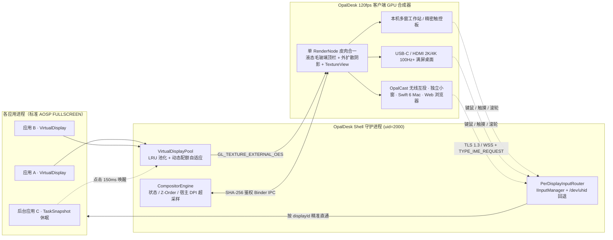

#  OpalDesk

> **在线体验**：[3D 交互舞台](https://lengsukq.github.io/OpalDesk/) ｜ [2D 实拍与多窗模拟器](https://lengsukq.github.io/OpalDesk/overview.html) ｜ [**Web 被投屏端 & 局域网激活**](https://lengsukq.github.io/OpalDesk/cast/) ｜ [使用指南](docs/USER_GUIDE.md) ｜ [架构设计](docs/ANDROID_WINDOW_ENGINE_DESIGN.md) ｜ [下载最新 Release](https://github.com/lengsukq/OpalDesk/releases/latest)

**全品牌安卓通用、免 Root 优先的 Wayland 式「一窗一独立虚拟屏」120fps 液态毛玻璃多窗合成工作站。**

彻底摒弃厂商私有 Freeform 小窗与撕裂悬浮标题栏路线，面向 **Android 11–17** 将 **macOS 液态毛玻璃多窗桌面**、**USB-C / HDMI 2K/4K 高刷外接满屏工作站**、**手机 ↔ 平板无线桌面与单应用悬浮小窗**、**物理键鼠全局跨屏路由**、**原生 Swift 6 macOS / Tauri v2 Windows 伴侣端** 与 **零安装 GitHub Pages Web 被投屏端 & 局域网免线激活** 集于一体，MIT 免费开源、零无障碍权限、95%+ 免 Root `uid=2000` 纯净运行。

---

## 📸 双机真机实拍（Xiaomi Pad 8 Pro · Xiaomi 14 Pro）

> 所有画面均直采自 **小米平板 8 Pro（Android 17 · 3040×1904）** 与 **小米 14 Pro（Android 16 · 1440×3200）** 真机实测。

### 1. 本机 120fps 液态毛玻璃多窗工作站（浅 / 深双主题 + 控制中心）

<table>
  <tr>
    <td width="50%" align="center">
      <br/>
      <sub><b>晴空浅色 50/50 左右分屏</b> · 一窗一独立 VirtualDisplay + 浮动液态毛玻璃程序坞</sub>
    </td>
    <td width="50%" align="center">
      <br/>
      <sub><b>曜石深色 + 实时控制中心</b> · 60–120Hz 帧率 / DPI 热刷新 / 7 套一键分屏模板 / 自定义壁纸</sub>
    </td>
  </tr>
</table>

### 2. 跨设备无线互联：手机 → 平板 120Hz 桌面投屏 & 单应用悬浮小窗

<table>
  <tr>
    <td width="50%" align="center">
      <br/>
      <sub><b>手机 → 平板 Wi-Fi TLS 无线投屏桌面（2560×1600 @ 120Hz）</b> · 独立竖屏形态零黑边 + 远端输入法自动转发</sub>
    </td>
    <td width="50%" align="center">
      <br/>
      <sub><b>跨设备独立应用全局悬浮小窗</b> · 来自小米 14 Pro 的应用以 macOS 毛玻璃小窗悬浮于平板之上（1:1 宿主 DPI 超采样）</sub>
    </td>
  </tr>
</table>

### 3. 手机端新版液态毛玻璃精密触控板 & 双端极简 Apple HIG 主控台

<table>
  <tr>
    <td width="25%" align="center">
      <br/>
      <sub><b>手机端精密触控板</b><br/>50/50 按键条 · 拖拽锁定 · 一键息屏</sub>
    </td>
    <td width="25%" align="center">
      <br/>
      <sub><b>手机端投屏态主控</b><br/>Wi-Fi TLS 直连 · 永久信任管理</sub>
    </td>
    <td width="50%" align="center">
      <br/>
      <sub><b>平板端极简三卡片主控台</b> · mDNS 自动发现互联设备 · 一键投屏桌面 / 应用小窗</sub>
      <br/><br/>
      <br/>
      <sub><b>设置页</b> · 常用排序 · GitHub Releases SHA-256 安全更新 · InputManager / <code>/dev/uhid</code> · 虚拟屏池配额</sub>
    </td>
  </tr>
</table>

---

## 🧭 为什么选 OpalDesk？（架构路线对比）

早期的安卓桌面方案大多采用「魔改系统 `WINDOWING_MODE_FREEFORM` + 悬浮窗贴片标题栏」，在跨品牌 ROM 升级、高刷拖拽、外接屏保活与权限门槛上存在结构性死结。OpalDesk 彻底采用 **Wayland 式独立虚拟屏池 + 客户端 GPU 单 `RenderNode` 统一合成**：

| 对比维度 | **OpalDesk（Wayland 式通用合成器）** | 传统 Freeform + 悬浮壳方案 | 厂商私有桌面（DeX / 电脑模式） |
| :--- | :--- | :--- | :--- |
| **窗口运行模式** | **100% 标准 AOSP `FULLSCREEN (1)`**，一窗一独立 `VirtualDisplay` | 魔改 `FREEFORM (5)` / 厂商私有反射，升级极易失效 | 深度绑定单一厂商框架，换机即不可用 |
| **标题栏与画面合成** | **单 `RenderNode` 皮肉合一**：纯拖拽 **0 IPC、0 虚拟屏重绘** | `SYSTEM_ALERT_WINDOW` 外挂贴片，拖拽撕裂错位 | 系统内置但难以自由定制毛玻璃与分屏模板 |
| **多窗并发与休眠** | **`VirtualDisplayPool` LRU 快照休眠**：突破 Android 14+ 配额，**150ms 唤醒** | 受系统小窗硬上限约束，容易互挤 | 固定 3–5 窗，不支持自定义快照池容量 |
| **跨设备无线互投** | **手机↔平板桌面/单应用悬浮小窗 + Swift 6 Mac + 零安装 Web 浏览器端（WebCodecs）** + 远端输入法自动转发 | 几乎无原生跨端能力 | 仅限同品牌生态全家桶 |
| **外接屏 & 物理键鼠** | **2K/4K 100Hz+ 独立满屏不中断** + 鼠标一键切本机/投屏端 + `/dev/uhid` 回退 | 切出 App 外接屏易黑屏，跨屏输入常被拦截 | 部分机型仅支持 60Hz 或缺少硬件键鼠路由 |
| **权限与安全模型** | **零无障碍 · 95%+ 免 Root**，守护进程强制降权 `uid=2000` + APK SHA-256 校验 | 强依赖敏感无障碍与常驻悬浮窗权限 | 闭源黑盒 |



---

## ✨ 核心特性一览

- **一窗一独立虚拟屏 + 宿主 DPI 超采样**：每窗独立切换 **桌面横屏 / 手机竖屏 / 平板 4:3**；`DisplayGeometryUtil.resolveWindowBufferSpec` 按宿主机原生密度超采样，根治微信等兼容应用小窗字体 2× 放大裁切与独立小窗闪动。
- **`VirtualDisplayPool` LRU 智能休眠**：动态适配 Android 14+ 严苛虚拟屏配额（3–8 实时屏可调），后台窗口自动捕获 `HardwareBuffer` 高清快照并释放槽位，点击 150ms 无缝唤醒。
- **120fps 皮肉合一液态毛玻璃桌面**：`ClipOp.Difference` 内部挖空多层外扩散阴影、浅/随系统/深三套主题、自定义相册壁纸、光标跟随右键菜单、按打开次数排序的统一应用启动器与 **7 套一键分屏模板**（`Alt+2/3/4/G`、`Alt+Tab`）。
- **跨设备无线互投 + 独立应用悬浮小窗 + 远端输入法转发**：免 PIN 交互式授权 + TLS 1.3 直连 + `OpalPeerCastMutex` 单向防环锁；支持 **手机↔平板完整桌面投屏**、**单应用全局悬浮小窗** 与 **Android→Mac（Swift 6）**，聚焦输入框自动通过 `TYPE_IME_REQUEST` 在接收端弹出本机键盘。
- **零安装 Web 被投屏端 & 局域网免线激活**：直接访问 **[OpalDesk Web 投屏端（GitHub Pages）](https://lengsukq.github.io/OpalDesk/cast/)**，守护进程 `:19878` 同端口首字节嗅探无缝兼容原生 TLS 与 `wss://`（以及 USB `adb forward` 本地免证书 `ws://127.0.0.1:19878/ws`）；浏览器通过 **WebCodecs (`VideoDecoder` / `AudioDecoder` + `AudioWorklet`)** 硬件直解 H.264/HEVC 与 48kHz AAC 音频，支持键鼠、10 指触控、中文 IME 桥、文本/图片粘贴、拖拽传文件与独立应用小窗；未激活时还可一键开启手机 `:19879` 临时前台激活服务，扫码免数据线在电脑浏览器完成远程激活并自动切入投屏。
- **精密触控板、物理熄屏与全局物理鼠标路由**：投屏期间本机秒变 120Hz 液态毛玻璃触控板（50/50 按键条 + 拖拽锁定 / 显示桌面 / 一键物理息屏并支持双击亮屏）；蓝牙/USB 鼠标可自由切换归属本机或投屏端，遇 ROM 封锁自动回退 Linux `/dev/uhid` 内核虚拟外设。
- **95%+ 免 Root 运行 & 内置 GitHub 安全更新**：五通道激活（内置 `libadb.so` 无线调试免电脑激活 / **Web 局域网扫码免线激活** / Shizuku / 电脑 ADB / 可选 Root 降权），内置应用更新直连 GitHub Releases 并执行 **SHA-256 摘要 + APK 包名双重校验**。

---

## 📦 下载与 30 秒免 Root 激活

前往 **[GitHub Releases（Latest）](https://github.com/lengsukq/OpalDesk/releases/latest)** 获取最新官方构建产物（已安装用户可在 App 内「设置 → 应用更新」一键检测并校验升级）：

- **Android 端（Android 11–17）**：下载最新 `OpalDesk_*.apk`（V3 正式签名 · 已内嵌守护进程 `opaldesk.jar`）
- **macOS 伴侣端（macOS 14+ · Apple Silicon）**：下载最新 `OpalDesk_*-macos.zip`（原生 Swift 6）
- **Windows 伴侣端（Windows 10/11 x64）**：下载最新 `OpalDesk_*-windows-x64-setup.exe` 或 `.msi`（Tauri v2 + WebView2 · 内置 mDNS 发现、TLS TOFU 免证书警告桥接与 USB 一键引导）
- **Web 被投屏端（Windows / Linux / macOS / 平板浏览器）**：免安装直接打开 **[https://lengsukq.github.io/OpalDesk/cast/](https://lengsukq.github.io/OpalDesk/cast/)**（推荐使用 Chrome / Edge / Firefox）

### 激活方式（任选其一，推荐 ① 或 ② 免数据线）
1. **本机内置无线调试（免电脑 · 推荐）**：打开系统「开发者选项 → 无线调试 → 使用配对码配对设备」，直接在顶部通知栏输入 6 位配对码即可自动以 `uid=2000` 拉起守护进程。
2. **Web 局域网免线激活（免数据线 · 免电脑装 ADB · 免切分屏）**：在手机 OpalDesk「激活 → Web激活」开启临时激活服务（5 分钟自动关闭），用电脑/平板浏览器扫描二维码打开 [Web 激活中心](https://lengsukq.github.io/OpalDesk/cast/?mode=activate)；手机直接停留在「无线调试 → 使用配对码配对设备」弹窗，电脑端输入 6 位配对码即可自动完成激活并无缝进入 Web 投屏。
3. **Shizuku / Sui 一键激活**：已启动 Shizuku 的设备可直接在 App 激活弹窗内一键授权启动。
4. **电脑单行 ADB 命令**：

<details>
<summary><strong>展开复制电脑单行 ADB 激活命令</strong></summary>

```bash
adb shell "rm -f /data/local/tmp/opd_src.apk /data/local/tmp/opaldesk.jar.new && pm path io.github.lengsukq.opaldesk | grep '^package:' | cut -d: -f2 | head -n1 | xargs cat > /data/local/tmp/opd_src.apk && test -s /data/local/tmp/opd_src.apk && unzip -p /data/local/tmp/opd_src.apk assets/opaldesk.jar > /data/local/tmp/opaldesk.jar.new && rm -f /data/local/tmp/opd_src.apk && test -s /data/local/tmp/opaldesk.jar.new && chmod 644 /data/local/tmp/opaldesk.jar.new && timeout 6 env CLASSPATH=/data/local/tmp/opaldesk.jar.new app_process /data/local/tmp io.github.lengsukq.opaldesk.daemon.OpalDeskDaemon --verify-helper >/dev/null 2>&1 && (timeout 8 env CLASSPATH=/data/local/tmp/opaldesk.jar.new app_process /data/local/tmp io.github.lengsukq.opaldesk.daemon.OpalDeskDaemon --stop >/dev/null 2>&1 || true) && ((pgrep -f '^app_process.*OpalDeskDaemon' >/dev/null 2>&1 || pgrep -f '^/system/bin/app_process.*OpalDeskDaemon' >/dev/null 2>&1) && (pkill -f '^app_process.*OpalDeskDaemon' 2>/dev/null; pkill -f '^/system/bin/app_process.*OpalDeskDaemon' 2>/dev/null; true) && sleep 1 && (pkill -f -l KILL '^app_process.*OpalDeskDaemon' 2>/dev/null; pkill -f -l KILL '^/system/bin/app_process.*OpalDeskDaemon' 2>/dev/null; true) || true) && rm -f /data/local/tmp/opaldesk.jar && mv -f /data/local/tmp/opaldesk.jar.new /data/local/tmp/opaldesk.jar && test -s /data/local/tmp/opaldesk.jar && (appops set io.github.lengsukq.opaldesk RUN_ANY_IN_BACKGROUND allow 2>/dev/null || true) && (appops set io.github.lengsukq.opaldesk ACCESS_RESTRICTED_SETTINGS allow 2>/dev/null || true) && (pm grant io.github.lengsukq.opaldesk android.permission.POST_NOTIFICATIONS 2>/dev/null || true) && (pm grant io.github.lengsukq.opaldesk android.permission.ACCESS_LOCAL_NETWORK 2>/dev/null || true) && (dumpsys deviceidle whitelist +io.github.lengsukq.opaldesk >/dev/null 2>&1 || true) && (CLASSPATH=/data/local/tmp/opaldesk.jar nohup app_process /data/local/tmp io.github.lengsukq.opaldesk.daemon.OpalDeskDaemon >/data/local/tmp/opaldesk.log 2>&1 </dev/null &)"
```

</details>

---

<details>
<summary><strong>🏗️ 模块目录结构、更新日志与本地编译部署</strong>（点击展开）</summary>

详细的架构约束与协作规范请参阅 **[AGENTS.md](AGENTS.md)**，完整版本演进记录请查阅 **[GitHub Releases](https://github.com/lengsukq/OpalDesk/releases)** 与 **[CHANGELOG.md](CHANGELOG.md)**。

```text
├── bridge/                  # Pure Java 11 Shell 守护进程 (:bridge -> assets/opaldesk.jar)
├── helper/                  # Kotlin 21 + Compose Foundation 客户端 APK (:helper)
├── macos/OpalDeskMac/       # 原生 Swift 6 macOS 伴侣接收端
├── windows/                 # Tauri v2 (Rust + WebView2) Windows 伴侣接收端（零拷贝复用 site/cast）
├── site/                    # 3D (WebGL2) + 2D 液态毛玻璃官方宣传网站 & site/cast/ Web 被投屏端/局域网激活中心
├── docs/                    # 使用指南与架构设计文档
└── scripts/                 # init-signing.sh / dev-deploy.sh / build-macos-app.sh
```

```bash
# 1. 初始化本地签名证书（首次克隆执行一次，生成 gitignored 的 opaldesk.p12）
./scripts/init-signing.sh

# 2. 运行 :bridge 与 :helper 全量纯 JVM 单元测试
./gradlew :bridge:test :helper:testDebugUnitTest

# 3. 编译正式签名 Release APK（自动编入 assets/opaldesk.jar）
./gradlew :helper:assembleRelease

# 4. 一键安装到设备并拉起守护进程
./scripts/dev-deploy.sh --logs

# 5. 编译测试原生 Swift 6 macOS 伴侣端
cd macos/OpalDeskMac && swift test && swift build -c release && ../../scripts/build-macos-app.sh --skip-build

# 6. 同步并测试 Tauri v2 Windows 伴侣端（Windows 下执行 npx @tauri-apps/cli build 打包安装包）
cd windows && npm test && cargo test --manifest-path src-tauri/Cargo.toml
```

</details>

---

## 📄 开源协议与致谢

- 基于 **[MIT License](LICENSE)** 免费开源；早期外接屏探索曾受 [duppjuzo/ExtBridge](https://github.com/duppjuzo/ExtBridge) 启发，现已完全重写为独立的全品牌通用免 Root Wayland 式多窗合成工作站。
- 第三方开源组件声明见 **[THIRD_PARTY_NOTICES.md](THIRD_PARTY_NOTICES.md)**。
